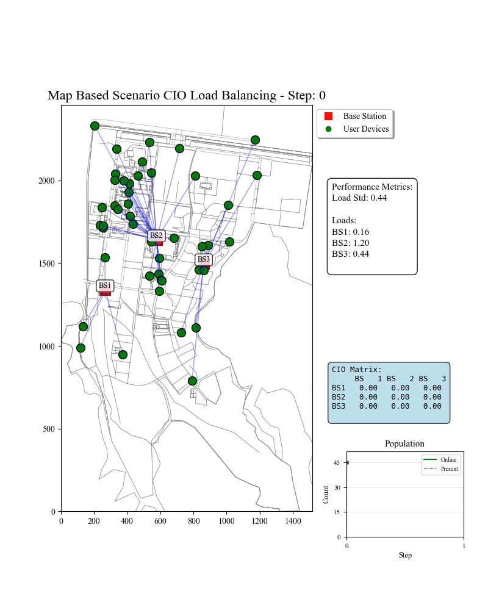

# Real-World Measurement-Driven Offline Reinforcement Learning for Mobility Load Balancing

> **⚠️ Disclaimer**:
>
> 1. This project and its accompanying paper have not yet undergone peer review. The code is intended for research purposes only. Please do __NOT__ download or use this repository at this stage.
> 2. Repository contents may be modified, added, or removed during peer review.
> 3. Results generated by this repository may differ from the final results presented in the paper, as some outputs require manual processing.

## 📖 Project Overview

This repository implements an offline reinforcement learning framework for **Mobility Load Balancing (MLB)** using **real-world radio measurement snapshots**. The proposed method, Link + Matched Value-Difference Learning (Link+MVD), combines a structured snapshot representation with an auxiliary critic-training objective.

MLB adjusts cell individual offsets (CIOs) to redistribute load among neighboring cells. Models of user association and radio resource demand enable offline reward relabeling: recorded radio measurements are reused to construct control trajectories under different CIO configurations, providing an offline dataset for policy learning.

The framework consists of three components:

1. **Offline Reward Relabeling**: Computes load-balancing rewards from measurement snapshots and candidate control configurations without collecting exploratory control actions in an operational network.
2. **Structured Snapshot Representation**: Combines mean and attention aggregation to encode population and directed-link context from unordered, incomplete user measurements. Recent snapshot context is fused with the current observation through a residual connection.
3. **Matched Value-Difference Learning (MVD)**: Adds a value-difference objective to the standard temporal-difference loss using transitions matched by measurement condition across different control rollouts.

Experiments cover one map-based simulation and three anonymized measurement-driven settings, **Site A**, **Site B**, and **Site C**. Each setting contains ten training environments and ten test environments. Both environment types expose snapshot observations to the policy.

The table below summarizes the publicly available project materials.

| Setting | Scenario data (`data/`) | Relabeled offline data (`offline_data/`) | Code | Results and checkpoints (`results/`) |
|---|:---:|:---:|:---:|:---:|
| Map-based simulation | ✓ | ✓ | ✓ | ✓ |
| Real-world measurement-driven settings | ✗ | ✗ | ✓ | ✓ |

✓ Publicly provided; ✗ Not distributed.

The repository includes SAC, SAC+MVD, Link, Link+MVD, Transformer SAC, CQL, and IQL, together with non-learning baselines, history-length experiments, matched-sampling ablations, offline-rollout-count experiments, and training/test performance curves.

## 🖼️ Visualizations

The animation below illustrates the map-based simulation environment.

<p align="center">
  <strong>Map-Based Scenario (OSM)</strong><br>
  
</p>

## 🛠️ Installation

1.  **Clone the repository:**
    ```bash
    git clone https://github.com/Zhao3miao/OfflineMLB.git
    cd OfflineMLB
    ```

2.  **Create and activate the Conda environment:**
    ```bash
    conda create -n offline_mlb python=3.7
    conda activate offline_mlb
    ```

3. **Install dependencies:**

    ```bash
    pip install -r requirements.txt
    ```

4. **Download the data and results:** Download the available archives from [Hugging Face](https://huggingface.co/buckets/Zhao3miao/OfflineMLB).

## 🚀 Quick Start & Reproduction

### 1. View Existing Results

After preparing the results archive, aggregate its evaluation records:

```bash
python scripts/summarize_results.py
```

The summary script writes `results/summary.json` and `results/summary.md`.

### 2. Reproduce Experiments

#### Step 1: Prepare Offline Data (Offline Reward Relabeling, Optional)

> **Note**: Skip this step if you have downloaded the prepared offline datasets.

```bash
python collect_offline_data.py \
  --env-list data/scenarios/map/train_envs.json \
  --output-dir offline_data/custom_map_64 \
  --rollouts 64 \
  --user-count-cap 100 \
  --seed 42
```

#### Step 2: Training


Train the proposed method on the public map dataset, using a separate output directory from the released checkpoints:

```bash
python train_link_mvd.py \
  --dataset offline_data/rollouts_64/map/train_manifest.json \
  --output-dir results/reproduced/map/link_mvd_h5/seed_42 \
  --history-length 5 \
  --seed 42 \
  --reward-scale 10
```

To use the offline data collected in Step 1, set `--dataset` to `offline_data/custom_map_64/train_manifest.json`.

With all required datasets prepared, run the main experiments for each seed:

```bash
bash scripts/run_main.sh 42
bash scripts/run_main.sh 233
bash scripts/run_main.sh 666
```

Run other suites in the same way, for example:

```bash
bash scripts/run_history.sh 42
bash scripts/run_ablation.sh 42
bash scripts/run_rollouts_32.sh 42
bash scripts/run_rollouts_128.sh 42
```

#### Step 3: Evaluation

Replay a selected checkpoint from the results archive:

```bash
python eval_link_mvd.py \
  --checkpoint results/main/map/link_mvd_h5/seed_42/selected.pt \
  --env-list data/scenarios/map/test_envs.json \
  --output results/replayed/map/link_mvd_h5_seed_42.json \
  --seed 42
```

To evaluate every saved checkpoint from the map run trained above and select the best checkpoint using training environments:

```bash
python eval_link_mvd.py \
  --run-dir results/reproduced/map/link_mvd_h5/seed_42 \
  --train-env-list data/scenarios/map/train_envs.json \
  --test-env-list data/scenarios/map/test_envs.json \
  --seed 42
```

#### Step 4: Aggregate Results

Regenerate the released result tables and numerical figure data:

```bash
python scripts/summarize_results.py --results-root results
```

## 📄 License

This project is released under the license specified in [LICENSE](LICENSE).

By submitting code, you agree that your contributions will be released under the same license as the project.

## 🔗 Citation

If you use this project in your research, please cite:

```bibtex
TODO
```
